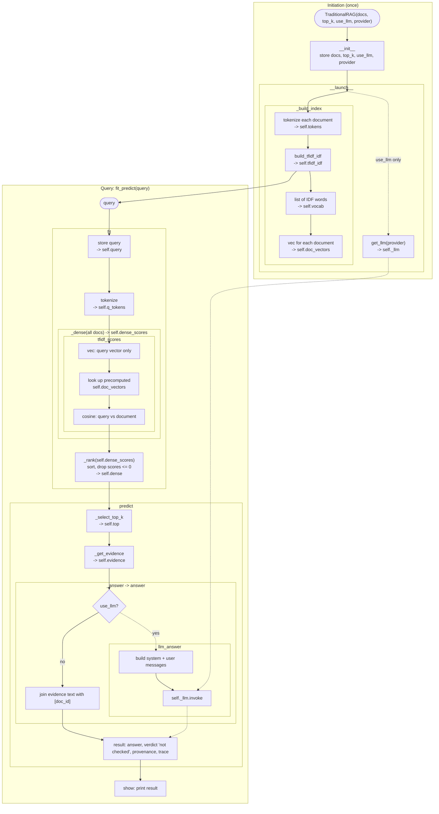

# GraphRAG

A small, self-contained comparison of **Traditional RAG** and **Graph RAG** over a synthetic
corpus of banking and Treasury documents in [docs/](docs/), implemented as three classes in
[main.py](main.py). Documents are split into chunks; chunks are what gets retrieved, while
permissions and graph relationships stay at the document level.

| Class               | What it does                                                                  |
| ------------------- | ----------------------------------------------------------------------------- |
| `TraditionalRAG`    | Chunks documents; TF-IDF top-k chunks. No permissions, no graph.              |
| `GraphRAG`          | ACL filter, BM25 + TF-IDF over chunks fused with RRF, document graph walk.    |
| `EmbeddingGraphRAG` | `GraphRAG`, but the dense step uses Ollama embeddings per chunk (FAISS).      |

The step-by-step sections below say "document" for the retrieval unit; read it as "chunk".
Since chunking was added, the rankings, RRF and seeds are all over chunks, and the graph walk
adds the best-matching chunk of each document it reaches (see
[Documents and chunking](#documents-and-chunking)).

## How `TraditionalRAG` works

From construction to answer. Each box inside `fit` and `predict` is one line of that method,
labelled with the attribute it sets. Nested boxes are the steps inside a called function.
The dotted path is the optional LLM route, taken only when `use_llm=True`; otherwise the
retrieved evidence is returned as the answer.



## How `GraphRAG` works

`GraphRAG` extends `TraditionalRAG`. At initiation it adds BM25 statistics and the graph. In `fit`
it adds an ACL filter and a second ranking: `dense` (TF-IDF cosine) and `lex` (BM25), both over the
allowed documents only. In `predict` it fuses the two rankings, walks the graph and checks citations.
In `GraphRAG` both rankings are keyword-based; only `EmbeddingGraphRAG` makes `dense` semantic.
`EmbeddingGraphRAG` follows exactly this flow, except that `_dense` calls Ollama embeddings
instead of `tfidf_scores`. The dotted path is the optional LLM route, taken only when `use_llm=True`.

```mermaid
flowchart TD
    subgraph INIT["Initiation (once)"]
        direction TB
        A(["GraphRAG(docs, edges, groups, top_k, hops, rrf_k, use_llm, provider)"]) --> I0["__init__<br/>store edges, groups, hops, rrf_k"]
        I0 --> I1["TraditionalRAG.__init__<br/>store docs, top_k, use_llm, provider"]
        I1 --> LAUNCH_IN

        subgraph LAUNCH["__launch__ (GraphRAG's own)"]
            direction TB
            LAUNCH_IN[" "]:::hidden
            LLMB["get_llm(provider)<br/>-> self._llm"]

            subgraph BUILD["_build_index"]
                direction TB
                T1["tokenize each document<br/>-> self.tokens"] --> T2["build_tfidf_idf<br/>-> self.tfidf_idf"]
                T2 --> TV["list of IDF words<br/>-> self.vocab"] --> TD["vec for each document<br/>-> self.doc_vectors"]
                TD --> T3["build_bm25_idf<br/>-> self.bm25_idf"]
            end

            AVG["_build_avg_len<br/>-> self.avg_len"]

            subgraph GRAPH["_build_graph -> self.adj"]
                direction TB
                G1["validate edge endpoints exist"] --> G2["add forward edge and reverse edge ~"]
            end

            LAUNCH_IN -.->|"use_llm only"| LLMB
            LAUNCH_IN --> T1
            T3 --> AVG --> G1
        end
    end

    subgraph QUERY["Query: fit_predict(query)"]
        direction TB
        Q(["query"]) --> F1

        subgraph FIT["fit"]
            direction TB
            F1["store query<br/>-> self.query"] --> F2["tokenize<br/>-> self.q_tokens"] --> F3["start audit trace<br/>-> self.trace"]

            subgraph ACL["_filter_acl -> self.allowed, self.trace"]
                direction TB
                C1["_allowed: user groups intersect document ACL"] --> C2["keep allowed docs, log counts in trace"]
            end

            F4["_dense(self.allowed)<br/>TF-IDF cosine (embeddings in EmbeddingGraphRAG)<br/>-> self.dense_scores"]
            F5["_rank(self.dense_scores)<br/>-> self.dense"]
            F6["_bm25(self.allowed)<br/>-> self.lex_scores"]
            F7["_rank(self.lex_scores)<br/>-> self.lex"]

            F3 --> C1
            C2 --> F4 --> F5 --> F6 --> F7
        end

        subgraph PREDICT["predict"]
            direction TB
            R1["Reciprocal Rank Fusion of self.lex + self.dense<br/>score = sum of 1 / (rrf_k + position + 1)"]
            R2["seeds = top_k fused docs"]

            subgraph WALK["_expand_graph(seeds) -> context, up to hops steps"]
                direction TB
                W1["for each frontier node, follow edges"] --> W2{"neighbor already in context?"}
                W2 -->|"no"| W3{"_allowed(neighbor)?"}
                W2 -->|"yes"| W5["skip"]
                W3 -->|"yes"| W4["add to context, next frontier"]
                W3 -->|"no"| W6["drop, log in trace"]
            end

            R3["evidence = text of every context document<br/>-> self.evidence"]

            subgraph ANSWER["_answer -> answer"]
                direction TB
                A0{"use_llm?"}
                A1["join evidence text with [doc_id]"]

                subgraph LLMA["llm_answer"]
                    direction TB
                    L1["build system + user messages"] --> L2["self._llm.invoke"]
                end

                A0 -->|"no"| A1
                A0 -.->|"yes"| L1
            end

            subgraph CITE["Citation check -> verdict"]
                direction TB
                K1["extract cited [doc_id] from answer"] --> K2{"cited and all in context?"}
                K2 -->|"yes"| K3["grounded"]
                K2 -->|"no"| K4["UNGROUNDED"]
            end

            P1["result: answer, verdict, provenance, trace"]

            R1 --> R2 --> W1
            W4 --> R3
            W5 --> R3
            W6 --> R3
            R3 --> A0
            A1 --> K1
            L2 -.-> K1
            K3 --> P1
            K4 --> P1
        end

        F7 --> R1
        P1 --> S1["show: print result"]
    end

    G2 --> Q
    LLMB -.-> L2

    classDef hidden fill:none,stroke:none,color:none,width:0px,height:0px;
```



### Graph expansion: `_expand_graph(seeds)`

`predict` hands the fused seeds to `_expand_graph`, which walks `self.adj` hop by hop (up to `hops`),
skips documents it has already reached, and drops any neighbor the user's groups may not read
(logging the drop in the trace). It returns a dictionary of document ID to how that document was
reached, in discovery order: seeds map to `"seed"`, and every discovered document maps to
`"hop{n}:{from}-{relationship}->{doc}"`, where `~` marks an edge followed in reverse.
`predict` uses its keys as the evidence and returns it as `provenance`.

With chunks, the walk moves between documents (edges link documents) and adds only the
best-matching chunk of each newly reached document (`hop_chunks`, default 1). Each provenance
entry also records the chunk's document, section and character span. Example for group `sre`
and the default query:

```python
{
    "incident_inc_2291#c0": {"doc_id": "incident_inc_2291", "section": "Postmortem INC-2291: ...", "reason": "seed", ...},
    "incident_inc_2291#c1": {"doc_id": "incident_inc_2291", "section": "Root cause", "reason": "seed", ...},
    "general_ledger#c2":    {"doc_id": "general_ledger", "section": "Dependencies", "reason": "seed", ...},
    "payments_platform#c1": {"doc_id": "payments_platform", "section": "Nightly settlement load",
                             "reason": "hop1:incident_inc_2291-ABOUT->payments_platform",
                             "relation": "incident_inc_2291 ABOUT payments_platform", ...},
}
# trace: "hop1: dropped irrbb_measurement via ~DEPENDS_ON (not entitled)"
```

## Setup

Requires Python 3.10+.

```bash
python -m venv .venv
.venv\Scripts\activate          # Windows (use `source .venv/bin/activate` elsewhere)
pip install -e ".[ollama]"      # or ".[anthropic]" / ".[ollama,anthropic,dev]"
```

The LLM provider is set by `PROVIDER` at the top of `main.py` (`"ollama"` or `"anthropic"`).
Copy `.env.example` to `.env` and fill in your settings (`.env` is gitignored):

| Variable             | Purpose                                             |
| -------------------- | --------------------------------------------------- |
| `ANTHROPIC_API_KEY`  | API key, needed only for the `anthropic` provider   |
| `OLLAMA_BASE_URL`    | Ollama server URL (default `http://localhost:11434`) |
| `OLLAMA_EMBED_MODEL` | Embedding model (default `nomic-embed-text`)        |

## Usage

```bash
python main.py                                    # GraphRAG as user group 'sre'
python main.py --model traditional                # TraditionalRAG
python main.py --model ollama                     # host and embed model come from .env
python main.py --model graph --groups sre finance --query "your question"
python main.py --save                             # build and save the index to VDB/
python main.py --load                             # answer from VDB/ (refused if docs/ changed)
python main.py --docs path/to/other/docs          # use another document folder
python main.py --model graph --eval               # evaluation on docs/evals.json (see below)
python main.py -h                                 # all options
```

## Documents and chunking

Source data lives in `docs/` and is loaded by `load_corpus()`; generated indexes live in `VDB/`.
Adding or replacing a document needs no code change: add the file and an entry in
`metadata.json`.

```
docs/
├── metadata.json        # chunking settings + one entry per document: doc_id, file, title, owner, acl
├── documents/*.md       # document text (synthetic banking and Treasury material, all fictional)
├── edges.json           # document relationships: source, relationship, target, description
└── evals.json           # labelled questions: id, query, groups, relevant passages, reference answer
```

| Document                  | ACL                          | Topic                                         |
| ------------------------- | ---------------------------- | --------------------------------------------- |
| `deposit_behaviour_model` | treasury, risk               | Non-maturity deposit model, betas, run-off    |
| `irrbb_measurement`       | treasury, risk, finance      | EVE / NII methodology and results             |
| `payments_platform`       | sre, data-eng                | Settlement data and the nightly load          |
| `general_ledger`          | finance, sre                 | Daily close and payment reconciliation        |
| `regulatory_reporting`    | finance, data-eng, risk      | Liquidity / IRRBB returns and data lineage    |
| `incident_inc_2291`       | sre, finance                 | Postmortem of a failed settlement load        |
| `alco_funding_strategy`   | treasury                     | Confidential hedging and funding decisions    |

**Chunking** (`TraditionalRAG.chunk_documents()` / `chunk_text()`, inherited by every class):

- Sentence-aware: headings, list and table lines are units; prose is split into sentences. Only a
  single unit longer than the chunk size is ever split mid-sentence.
- Default `chunk_size` 400 and `overlap` 60, set in `metadata.json` (`"strategy": "document"`
  keeps documents whole). Sizes count index tokens, the lowercase `\w+` words that TF-IDF and
  BM25 use, so the size is exactly what the retriever sees.
- A heading starts a new chunk (unless the current one is under a quarter full) and overlap is
  never carried across a heading. On this corpus every section is under 400 tokens, so chunks
  follow sections (27 chunks from 7 documents) and overlap only appears in longer sections.
- Each chunk keeps `chunk_id` (`<doc_id>#c<position>`), `doc_id`, `position`, `text` (exactly
  `document[start_char:end_char]`), `section`, `token_count`, `title`, `source` and the document's
  `acl`. Provenance and LLM citations use the chunk ID, and every chunk traces back to its span.

Evaluation labels are exact quotes (`{"doc_id", "quote"}`), not chunk IDs, so they survive changes
to the chunk settings; `load_corpus()` fails if a quote no longer appears in its document.

## Evaluation and monitoring

`calc_metric(query, relevant, groups, k=None, reference=None, judge=None)` runs one request through
`fit()` and `predict()`, exactly as production does, and returns one record with five sections:
`retrieval`, `answer`, `security`, `performance` and `labels`. With labels it is an **offline
evaluation**; with `relevant=None` and no reference it measures only what a live request can
(**runtime monitoring**). `evaluate()` runs `EVAL_SET` (hand-labelled queries, groups, relevant
documents and verified reference answers), and `report()` turns the records into four Polars tables.

```bash
python main.py -m graph -e                      # retrieval, latency, security; no LLM calls
python main.py -m graph -e --llm                # also generate answers (tokens, cost, answer metrics)
python main.py -m graph -e --llm --judge        # also LLM-judge faithfulness, correctness, relevance
python main.py -m ollama -e --repeats 20        # more requests for steadier P95
```

| Metric | Needs | Monitor | Classes / stages |
| --- | --- | --- | --- |
| Precision@K, Recall@K, NDCG@K, MRR | relevance labels | offline, per release | all; `dense`, `context`; Graph adds `bm25`, `rrf` (MRR/NDCG ranked stages only) |
| Answer token F1 | reference answer | offline | all, with `--llm` |
| Judge correctness | reference + LLM judge | offline | all, with `--llm --judge` |
| Judge faithfulness, judge context relevance | LLM judge | continuously, on a sample | all |
| Lexical support (hallucination alarm) | nothing | continuously | all, with `--llm` |
| P50 / P95 retrieval and end-to-end latency | telemetry | continuously | all |
| Error and timeout rates | telemetry | continuously | all |
| Input / output tokens, API cost | provider usage + price table | continuously | all, with `--llm` |
| Unauthorized documents in retrieval or LLM context | ACLs only | continuously, target 0 | all |

- `TraditionalRAG.calc_metric()` holds everything shared. `GraphRAG.calc_metric()` calls `super()`
  and adds the `bm25` and `rrf` stages. `EmbeddingGraphRAG` inherits it unchanged.
- The `context` stage is what the LLM receives: top-K for `TraditionalRAG`, seeds plus graph
  neighbours for the graph classes. It is unranked, so it has precision, recall and leaks only.
- Judge scores are LLM estimates, kept under `answer.judge`; everything else is deterministic.
  A citation-ID check alone is not faithfulness.
- Missing values are `None`, never a misleading 0: unpriced (self-hosted) models have no cost,
  unlabelled requests have no precision, and failed judge calls are listed in `answer.judge.errors`.
- API prices live in `LLM_PRICES_PER_MTOK`; Ollama models are self-hosted and unpriced.

`python test_metrics.py` checks every metric against hand-computed values, using fake LLM, judge
and Ollama objects (no network).

## Persisted index (`VDB/`)

`GraphRAG` and `EmbeddingGraphRAG` save their query-independent indexes and load them back
without rechunking, retokenizing or re-embedding anything. Each part uses a format that suits it.

```python
from main import DOCS, EDGES, GraphRAG, VDB_PATH

GraphRAG(DOCS, EDGES, ["sre"], use_llm=False).save_index()               # writes VDB/
rag = GraphRAG(None, None, ["sre"], use_llm=False, index_path=VDB_PATH)  # loads, no rebuild
rag.fit("payments table failure").predict()
```

| File                          | Format  | Contents                                                      | Restores                     |
| ----------------------------- | ------- | ------------------------------------------------------------- | ---------------------------- |
| `metadata.json`               | JSON    | `doc_ids`, `chunk_ids`, config (incl. chunking), source fingerprint | ordering, freshness check |
| `documents.json`              | JSON    | `doc_id` -> text, ACL groups, title, file                      | `docs`                       |
| `chunks.parquet`              | Parquet | `chunk_id`, `doc_id`, `position`, char span, `section`, text   | `chunks`, `doc_chunks`       |
| `graph.json`                  | JSON    | directed document edges `[source, relationship, target]`       | `edges`, `adj`               |
| `bm25_postings.parquet`       | Parquet | `term`, `chunk_id`, `tf` (inverted index)                      | `bm25_tf`                    |
| `bm25_chunks.parquet`         | Parquet | `chunk_id`, `chunk_len`                                        | `bm25_chunk_len`             |
| `bm25_stats.parquet`          | Parquet | `term`, `df`, `n_chunks`, `avg_chunk_len`                      | `bm25_idf`, `avg_len`        |
| `graph/tfidf.npz`             | SciPy   | CSR matrix, rows = chunks, columns = vocabulary (GraphRAG only) | `chunk_vectors`             |
| `graph/tfidf_metadata.json`   | JSON    | `chunk_ids`, `vocab`, `tfidf_idf`                              | `vocab`, `tfidf_idf`         |
| `embedding/embeddings.faiss`  | FAISS   | one normalized row per chunk (EmbeddingGraphRAG only)          | `faiss_index`                |
| `embedding/embeddings_metadata.json` | JSON | row -> `chunk_id`, embedding model, dimension             | `faiss_chunk_ids`            |

- **Stale indexes are refused.** `metadata.json` stores a SHA-256 of every document's text and
  ACL, of the edges, and the chunking settings. Loading compares them with the current source
  (`docs/`, or the `docs`/`edges` passed in) and raises an error naming the changed, added or
  removed documents. Rebuild with `python main.py --save`.
- Chunk ACLs are re-inherited from `documents.json` on load, so a chunk can never carry a
  different ACL from its document. BM25 IDF is recomputed from `df`; reverse graph links are
  rebuilt from the directed edges.

Inspect the files with Polars or DuckDB:

```python
import polars as pl

df = pl.read_parquet("VDB/chunks.parquet")
```

```python
import duckdb

df = duckdb.sql("""
    SELECT *
    FROM 'VDB/bm25_postings.parquet'
""").pl()
```

`python test_index_persistence.py` builds, queries, saves, reloads and checks that scores,
rankings, ACL results and graph evidence are identical, that FAISS rows map to the right chunks
with no re-embedding, and that stale indexes are refused.

## Project layout

```
main.py                    # corpus loader, the three RAG classes, evaluation and the CLI
docs/                      # source documents, ACLs, edges and evaluation set (see above)
test_chunking.py           # chunk boundaries, overlap, metadata, deterministic IDs
test_index_persistence.py  # save_index / load_index round trip and stale-index checks
test_metrics.py            # calc_metric(), ACLs, citations, relevance, before/after chunking
VDB/                       # generated index (Parquet, NPZ, JSON, FAISS); git-ignored
pyproject.toml             # packaging, dependencies, ruff config
.env.example               # template for local settings (copy to .env)
.vscode/                   # shared editor settings (loads .env into the integrated terminal)
LICENSE                    # MIT
```

## Branches

| Branch | Purpose                                  |
| ------ | ---------------------------------------- |
| `main` | Stable baseline (protected)              |
| `Dev`  | Active development                       |
| `UAT`  | User acceptance testing before `main`    |

All three branches are on GitHub. `main` is protected, so work is committed and pushed to `Dev`
and reaches `main` through a pull request.

## Status

Working prototype on seven synthetic banking documents (27 chunks) in `docs/`. All three
classes run end to end, with and without the LLM. Recent structural changes:

- Documents, ACLs, edges and the evaluation set moved from `main.py` into `docs/`.
- Retrieval is chunk-level (sentence-aware, 400 / 60 tokens); ACLs and graph edges stay document-level.

- Pure helpers (`tokenize`, `build_tfidf_idf`, `vec`, `cosine`, `_rank`, `build_bm25_idf`, `get_llm`) are `@staticmethod`s.
- The LLM is built once in `__launch__` as `self._llm` and used by `llm_answer`.
- Ollama host and embedding model come from `.env`; the `--host` and `--embed-model` flags were removed.
- `OllamaGraphRAG` was renamed `EmbeddingGraphRAG` (still selected with `--model ollama`).
- In `GraphRAG`, both rankings (`self.lex`, `self.dense`) are computed in `fit`; `predict` only fuses, walks the graph and answers.
- `GraphRAG.fit`, `__launch__` and `_build_index` no longer call `super()`; they repeat the inherited steps inline.
- Document TF-IDF vectors are computed once in `_build_index` (`self.vocab`, `self.doc_vectors`); at query time `tfidf_scores` builds only the query vector.
- The graph walk moved out of `GraphRAG.predict` into `_expand_graph(seeds)`; behavior is unchanged.
- Each step in `fit`/`predict` is one line with a named intermediate (e.g. `self.dense_scores`, then `self.dense`), and a single shared `_rank` sorts both rankings.

Known gaps:

- **No CI.** Tests run locally with `python test_*.py` or `pytest`.
- **Provider selection.** The CLI has no `--provider` flag; the provider comes from `PROVIDER` in `main.py`, and the `use_llm` default differs for `EmbeddingGraphRAG` (off) versus the other two (on).
- **Permission leaks in the audit trace.** It lists IDs of documents the user may not see, and IDF statistics include restricted documents.
- **Weak citation check.** It verifies that cited chunk or document IDs exist in the context, not that claims are supported.
- **`GraphRAG` requires `edges`.** Passing `None` raises an error.
- **Performance.** Chunk vectors are dense lists over the whole vocabulary, and the graph walk has no context cap. `EmbeddingGraphRAG` still builds TF-IDF chunk vectors it never uses.
- **Small evaluation set.** `docs/evals.json` has 12 labelled questions; one question changes the averages noticeably.
- **Graph walk takes one chunk per document.** With `hop_chunks=1` it can pick a neighbour's wrong section; `hop_chunks=2` raised context recall from 0.89 to 0.92 for 31% more context.

## License

MIT. See [LICENSE](LICENSE).
