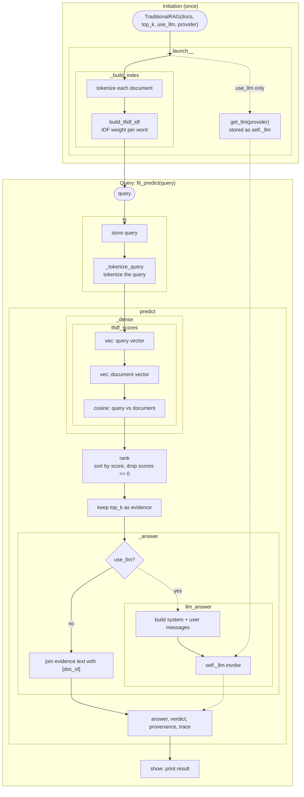

# GraphRAG

A small, self-contained comparison of **Traditional RAG** and **Graph RAG** on a toy
corpus of services and tables, implemented as three classes in [main.py](main.py):

| Class            | What it does                                                                     |
| ---------------- | -------------------------------------------------------------------------------- |
| `TraditionalRAG` | TF-IDF top-k over everything. No permissions, no graph, no citation check.       |
| `GraphRAG`       | ACL filter, BM25 + TF-IDF fused with RRF, graph walk, citation check.            |
| `OllamaGraphRAG` | `GraphRAG`, but the dense retrieval step uses an Ollama embedding model.         |

## How `TraditionalRAG` works

From construction to answer. The dotted path is the optional LLM route, taken only when `use_llm=True`;
otherwise the retrieved evidence is returned as the answer.



## Setup

Requires Python 3.10+.

```bash
python -m venv .venv
.venv\Scripts\activate          # Windows (use `source .venv/bin/activate` elsewhere)
pip install -e ".[ollama]"      # or ".[anthropic]" / ".[ollama,anthropic,dev]"
```

The LLM provider is set by `PROVIDER` at the top of `main.py` (`"ollama"` or `"anthropic"`).
Copy `.env.example` to `.env` and fill in your settings (`.env` is gitignored):

| Variable             | Purpose                                             |
| -------------------- | --------------------------------------------------- |
| `ANTHROPIC_API_KEY`  | API key, needed only for the `anthropic` provider   |
| `OLLAMA_BASE_URL`    | Ollama server URL (default `http://localhost:11434`) |
| `OLLAMA_EMBED_MODEL` | Embedding model (default `nomic-embed-text`)        |

## Usage

```bash
python main.py                                    # GraphRAG as user group 'sre'
python main.py --model traditional                # TraditionalRAG
python main.py --model ollama                     # host and embed model come from .env
python main.py --model graph --groups sre finance --query "your question"
python main.py -h                                 # all options
```

## Project layout

```
main.py         # corpus, the three RAG classes, and the CLI
pyproject.toml  # packaging, dependencies, ruff config
.env.example    # template for local settings (copy to .env)
.vscode/        # shared editor settings (loads .env into the integrated terminal)
LICENSE         # MIT
```

## Branches

| Branch | Purpose                                  |
| ------ | ---------------------------------------- |
| `main` | Stable baseline                          |
| `Dev`  | Active development                       |
| `UAT`  | User acceptance testing before `main`    |

`Dev` and `UAT` currently exist locally only; push them with `git push -u origin Dev UAT`.

## Status

Working prototype on a five-document toy corpus. Not yet verified end to end in a
clean environment after the latest refactors (method reordering, `.env` config).

Known gaps:

- **No tests or CI.** The ACL filter, graph hops, RRF fusion and both IDF functions are the first candidates.
- **Provider selection.** The CLI has no `--provider` flag; the provider comes from `PROVIDER` in `main.py`, and the `use_llm` default differs for `OllamaGraphRAG` (off) versus the other two (on).
- **Permission leaks in the audit trace.** It lists IDs of documents the user may not see, and IDF statistics include restricted documents.
- **Weak citation check.** It verifies that cited IDs exist in the context, not that claims are supported, and its regex ignores IDs containing `-` or `.`.
- **`GraphRAG` requires `edges`.** Passing `None` raises an error.
- **Performance.** TF-IDF vectors are rebuilt per query and the graph walk has no context cap.
- **No retrieval evaluation** (e.g. recall@k) to compare the three models.

## License

MIT. See [LICENSE](LICENSE).
